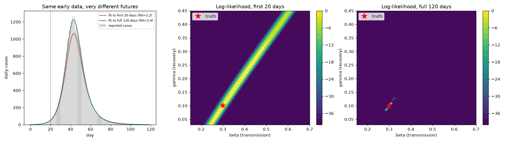

# SIR Epidemic Model Fitting

> Early in an outbreak, your data knows how fast cases are growing. It does not know R0, however confident the model output looks.

## Demo Output

Produced from a simulated outbreak by `demo.py`: SIR fits to the first 20 days and to the whole epidemic, and the likelihood surface over transmission (beta) and recovery (gamma) in each case.

## Why This Exists

The SIR model has two parameters, but the early exponential phase only measures one combination of them: the growth rate, beta minus gamma. Any pair on that line fits the first weeks equally well, and each pair implies a different R0, peak and final size. This repo fits the model by Poisson likelihood over a grid, so you can *see* the ridge instead of trusting a single best-fit number.

## What's Inside

| Function | Purpose |
|----------|---------|
| `sir_incidence` | Daily new infections by RK4, vectorised over parameter grids |
| `likelihood_surface` | Poisson log-likelihood of reported cases (known reporting rate) on a beta x gamma grid |
| `r0_interval` | Best R0 plus an approximate 95% range from the likelihood region |

## How to Break the Ridge

| Extra information | Pins down |
|-------------------|-----------|
| Data past the peak | Both parameters |
| Known infectious period (clinical studies) | gamma, so R0 follows from the growth rate |
| Serial-interval data | The generation time, linking growth rate to R0 |

## When NOT to Use This

- **Real outbreaks.** Reporting rates change, interventions change beta, and populations aren't well mixed. Use SEIR models with time-varying transmission and proper uncertainty (for example EpiNow2).
- **The reporting rate is assumed known here.** In practice it's confounded with population size and susceptibility.
- **Overdispersed counts.** Real case data usually need a negative binomial likelihood.

## The Uncomfortable Truth

A single early-outbreak R0 from curve fitting is mostly an assumption about the infectious period, presented as a result.

## Further Reading

- Kermack W. O. & McKendrick A. G. "A contribution to the mathematical theory of epidemics." Proceedings of the Royal Society A (1927).
- Wallinga J. & Lipsitch M. "How generation intervals shape the relationship between growth rates and reproductive numbers." Proceedings of the Royal Society B (2007).
- Keeling M. J. & Rohani P. "Modeling Infectious Diseases in Humans and Animals." Princeton University Press (2008).
